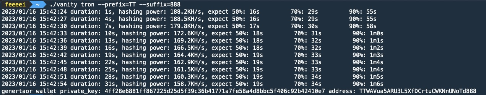

English | [中文](./README_ZH-CN.md)

# vanity-generator

`vanity-generator` is a blockchain wallet vanity number generator implemented in Go. It is highly efficient, capable of generating over 200,000 vanity addresses per second on a single core and millions per second on multiple cores.

Wallet generation is currently supported for four networks: `Ethereum`、`Tron`、`Polkadot`、`Monero`.



### Features:

- Purely local generation, no internet connection required, can be used as a cold wallet
- 100% based on the official project code of [go-ethereum](https://github.com/ethereum/go-ethereum), providing better security
- Implemented in Go language, generating efficiency is <strong>several tens of times</strong> higher than the [JS version](https://vanity-eth.tk/)
- Supports specifying prefix and suffix, supports specifying both at the same time
- Provides estimated time, default provides estimated time of 50%, 70%, 90% probability
- Native high concurrency support, default uses all CPU cores

### Native Usage:
Command: `./vanity {eth/tron/dot/xmr} --prefix=xxxx --suffix=xxx --concurrency=1`

It is recommended to use with commands such as `screen` or `nohup`.

### Usage with Docker:
Create a configuration file at /etc/vanity/config.json with the following format:
```json
{
  "wallet": "eth",
  "prefix": "xxxx",
  "suffix": "xxxx",
  "concurrency": 1,
  "mnemonic": false,
  "words": 24
}
```
Command: 
```shell
docker pull feeeei/vanity-generator
docker run --name=vanity -v /etc/vanity:/etc/vanity feeeei/vanity-generator
```

### Parameter Description:

- `--prefix`: Specify prefix, ETH needs to start with `0x`, Tron needs to start with `T`, Monero needs to start with `4` and its second character can only be `1-9`, `A` or `B`.
- `--suffix`: Specify suffix, ETH needs to satisfy [0-9A-Fa-f], Tron and Monero need to satisfy Base58.
- `--concurrency`: Number of concurrent processes, if not specified, it is equal to the number of CPU cores by default.
- `--mnemonic`: Derive ETH/Tron wallets from a BIP39 mnemonic (path `m/44'/60'/0'/0/0` / `m/44'/195'/0'/0/0`, the first account of MetaMask / TronLink) instead of a random private key. Polkadot and Monero are always mnemonic based. Every attempt costs 2048 rounds of PBKDF2, so this mode is about 40x slower than the default one.
- `--words`: Mnemonic word count, `12` or `24`, default `24`. Passing it implies `--mnemonic` for ETH/Tron. Monero seeds are always 25 words, so it is rejected there.
- Monero generates standard mainnet addresses (starting with `4`).
- `wallet.json` fields: `address`, `private_key` (ETH/Tron), `mnemonic` (mnemonic mode, Polkadot and Monero) and `path` (ETH/Tron mnemonic mode).
