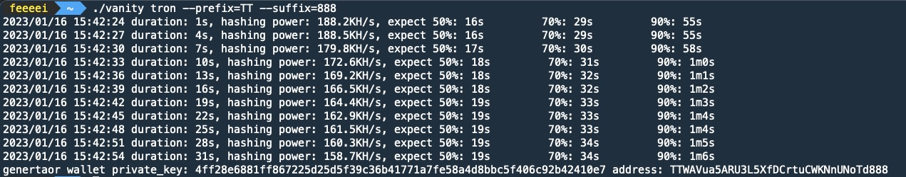

[English](./README.md) | 中文

# vanity-generator

`vanity-generator` 是一款基于Go语言实现的区块链钱包靓号生成工具，效率超高，单核可以做到每秒生成超过20w+次，多核每秒几百万次。

现支持`ethereum`、`tron`、`polkadot`、`monero`四种网络的钱包生成。



### 特性：
- 纯本地生成，不联网，可作为冷钱包使用
- 100% 基于官方项目 [go-ethereum](https://github.com/ethereum/go-ethereum) 代码生成，安全性更佳
- 基于Go语言实现，生成效率<strong>几十倍</strong>于[前端JS版本](https://vanity-eth.tk/)
- 支持前缀+后缀指定，支持同时指定
- 提供预计耗时，默认提供50%概率、70%概率、90%概率的预计耗时
- 原生高并发支持，默认打满CPU核数

### 原生使用
命令：`./vanity {eth/tron/dot/xmr} --prefix=xxxx --suffix=xxx --concurrency=1`

推荐搭配 `screen` 或者 `nohup` 等命令使用。

### 通过Docker使用
创建配置文件 `/etc/vanity/config.json`，格式为：
```json
{
  "wallet": "eth",
  "prefix": "xxxx",
  "suffix": "xxxx",
  "concurrency": 1,
  "mnemonic": false,
  "words": 24
}
```
命令：
```shell
docker pull feeeei/vanity-generator
docker run --name=vanity -v /etc/vanity:/etc/vanity feeeei/vanity-generator
```

### 参数说明
- `--prefix`: 前缀指定，ETH需要 `0x` 开头，Tron需要 `T` 开头，Monero需要 `4` 开头且第二位只能是 `1-9`、`A`、`B`。
- `--suffix`: 后缀指定，ETH需要 [0-9A-Fa-f]，Tron、Monero需要满足 Base58。
- `--concurrency`: 并发数量，不传递默认等于CPU核数。
- `--mnemonic`: ETH、Tron 改为从 BIP39 助记词派生（路径 `m/44'/60'/0'/0/0`、`m/44'/195'/0'/0/0`，即 MetaMask、TronLink 的第一个账户），而不是直接随机私钥。Polkadot、Monero 本身就是助记词生成。助记词模式每次尝试要做 2048 轮 PBKDF2，速度约为普通模式的 1/40。
- `--words`: 助记词单词数，`12` 或 `24`，默认 `24`；传了即等同于开启 `--mnemonic`。Monero 种子固定 25 词，传该参数会报错。
- Monero 生成的是主网标准地址（`4` 开头）。
- `wallet.json` 字段：`address`、`private_key`（ETH、Tron）、`mnemonic`（助记词模式及 Polkadot、Monero）、`path`（ETH、Tron 助记词模式）。
